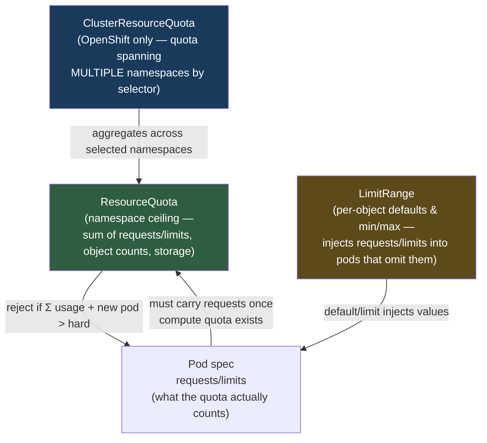
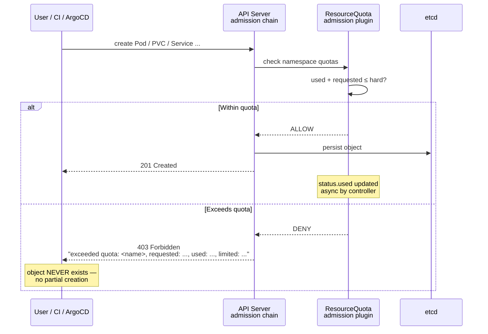
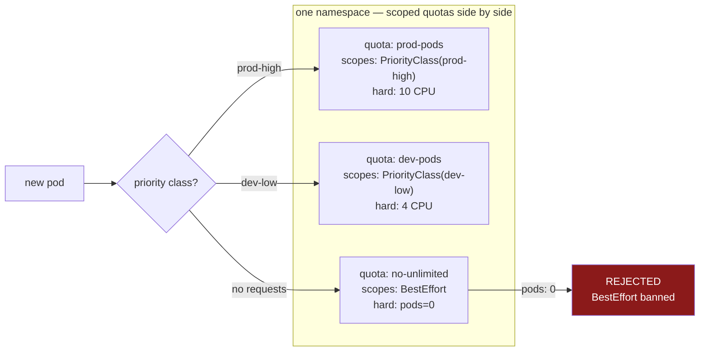
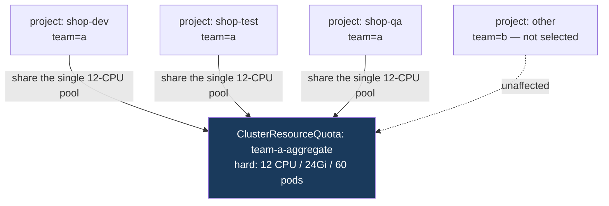
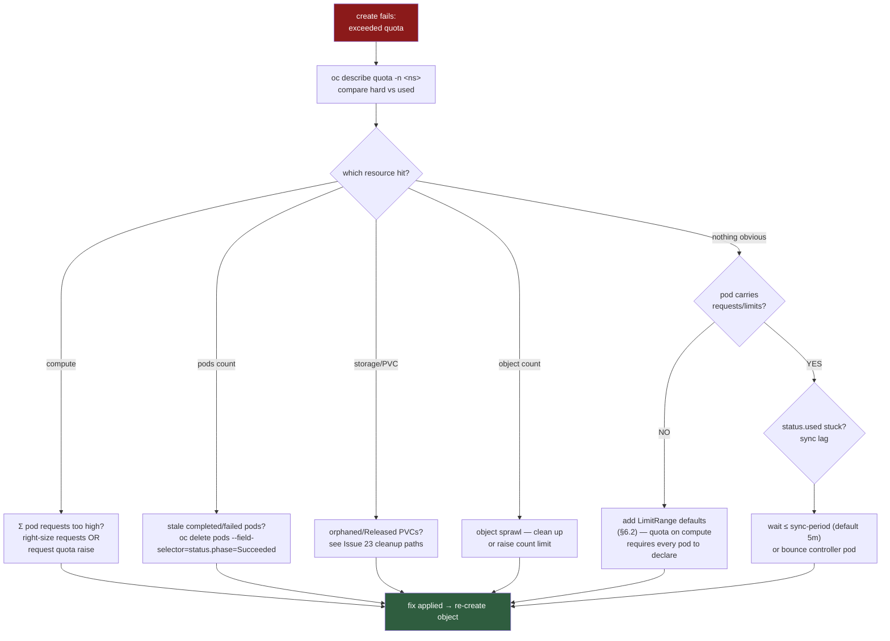
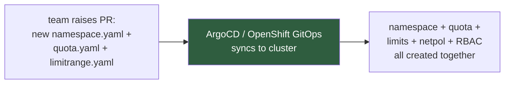

# ResourceQuota Controls — Namespace Resource Governance on OpenShift

| Field | Detail |
|---|---|
| **Document status** | **DOCUMENTED** — reference/procedure guide, tested on the lab cluster |
| **Cluster** | lab.ocp.local — OpenShift 4.20.35, 3 control-plane + 2 worker nodes (dev/test) |
| **Category** | Namespace governance / multi-tenancy / capacity management |
| **Audience** | OCP administrators, platform engineers, GitOps operators |
| **Related** | Namespace onboarding automation, LimitRange defaults, ClusterResourceQuota (multi-project) |

---

## 1. What ResourceQuota Is — and Why It Exists

A **ResourceQuota** is a namespace-scoped object that sets a **hard ceiling** on the total
resources a namespace may consume. On a shared cluster, quotas are the **bulkhead**:
one team can never consume so much CPU, memory, storage, or object count that it sinks
the other tenants.

Without quotas, every namespace competes for the whole cluster — first come, first served.
With quotas, each namespace gets a bounded slice, enforced at **admission time** (before
the object is persisted), not after the fact.

```mermaid
flowchart TD
    subgraph CLUSTER["Shared OCP Cluster — total capacity"]
        subgraph NS1["namespace: team-a<br/>quota: 8 CPU / 16Gi"]
            P1["pods<br/>Σ requests ≤ 8 CPU"]
        end
        subgraph NS2["namespace: team-b<br/>quota: 4 CPU / 8Gi"]
            P2["pods<br/>Σ requests ≤ 4 CPU"]
        end
        subgraph NS3["namespace: batch-jobs<br/>quota: 2 CPU / 4Gi"]
            P3["pods<br/>Σ requests ≤ 2 CPU"]
        end
    end
    X["noisy-neighbor workload<br/>tries to exceed its quota"] -->|REJECTED at admission| NS3
    style X fill:#8b1a1a,color:#fff
    style NS3 fill:#3d2f00
```



---

## 2. The Governance Stack — How the Pieces Fit

ResourceQuota never works alone. The complete namespace-governance model has four layers:



| Layer | Scope | Purpose |
|---|---|---|
| **ClusterResourceQuota** | Many namespaces (label selector) | OCP-only. Give a *team* a pool spanning its dev/test/qa projects |
| **ResourceQuota** | One namespace | Hard ceiling on Σ requests, Σ limits, storage, object counts |
| **LimitRange** | One namespace | Per-container/pod min, max, and **defaults** — makes quota enforcement usable |
| **requests/limits** | Each container | The units the quota counts |

> **The critical interaction:** once a compute quota (`requests.cpu`, `requests.memory`,
> `limits.cpu`, `limits.memory`) exists in a namespace, **every new pod must declare
> those values** or it is rejected. A LimitRange with defaults is what keeps
> "developer applies a pod with no requests" from becoming a wall of quota errors.

---

## 3. Enforcement — Where the Rejection Happens

Quota is enforced by the **API-server admission controller**, not by the scheduler or
kubelet. The object's `status.used` is a cache refreshed asynchronously
(`resource-quota-sync-period`, default 5m on the controller).



**Consequences of admission-time enforcement:**

- Failures appear as `403 Forbidden` / `Error from server (Forbidden): pods "x" is forbidden: exceeded quota` — **not** as Pending pods.
- Quota counts **requests** (and limits), not real usage. A pod requesting 1 CPU counts 1 CPU even while idling at 10m.
- `status.used` can lag actual objects by up to the sync period — newly deleted pods may still count briefly.

---

## 4. What Can Be Quota'd — The Full Matrix

### 4.1 Compute & storage

| Quota key | Counts | Notes |
|---|---|---|
| `requests.cpu` / `requests.memory` | Σ pod requests | Primary scheduling contract |
| `limits.cpu` / `limits.memory` | Σ pod limits | Cap the cap |
| `requests.storage` | Σ PVC sizes | All StorageClasses combined |
| `<storage-class>.storageclass.storage.k8s.io/requests.storage` | Σ PVC size per class | e.g. `nfs.csi.storageclass.storage.k8s.io/requests.storage` |
| `persistentvolumeclaims` | Count of PVCs | Prevent claim sprawl |

### 4.2 Object counts (defends the control plane, not the nodes)

| Quota key | Protects against |
|---|---|
| `pods` | Pod flood |
| `services`, `services.loadbalancers`, `services.nodeports` | Service/LB sprawl |
| `secrets`, `configmaps` | etcd bloat |
| `replicationcontrollers`, `deployments.apps`, `statefulsets.apps`, `jobs.batch`, `cronjobs.batch`, `deploymentconfigs.apps.openshift.io` | Object sprawl per kind |
| `count/<resource>.<group>` | **Any** resource, incl. CRDs — e.g. `count/routes.route.openshift.io: 10` |

### 4.3 Scopes — quota that applies only to matching pods

| Scope | Selects pods that are… | Typical use |
|---|---|---|
| `BestEffort` | no requests/limits at all | Cap unbounded pods: `scopes: [BestEffort]`, `hard: pods: "0"` bans them outright |
| `NotBestEffort` | have at least one request/limit | Normal compute quotas |
| `Terminating` | have `spec.activeDeadlineSeconds` | Reserve room for jobs |
| `NotTerminating` | long-running | Default workloads |
| `PriorityClass` | `priorityClassName` in a list | Give prod pods a bigger slice than dev |



---

## 5. OpenShift-Specific Mechanics

### 5.1 ClusterResourceQuota — one pool, many projects

```yaml
apiVersion: quota.openshift.io/v1
kind: ClusterResourceQuota
metadata:
  name: team-a-aggregate
spec:
  selector:
    labels:
      team: a                      # every project with label team=a shares ONE pool
  quota:
    hard:
      requests.cpu: "12"
      requests.memory: 24Gi
      pods: "60"
```

- Selected via namespace **labels** (`spec.selector.labels`) or annotation
  `openshift.io/quota: <crq-name>` (`spec.selector.annotations`).
- **Rate-limited deliberately:** CRQ usage syncs slowly (~minutes by design) so it is
  not suited to instantaneous enforcement — plan buffer accordingly.
- A namespace can be selected by only **one** CRQ.



### 5.2 Other OCP nuances

- Default projects (`openshift-*`, `kube-*`, `default`) should **never** carry user quotas.
- The Project Request Template (`project.config.openshift.io/cluster`) can ship
  ResourceQuota + LimitRange into **every** new project automatically — the clean way
  to make quotas default-on.
- `oc describe quota` / `oc get quota` works identically to `kubectl`; CRQ is
  `oc describe clusterquota`.

---

## 6. Reference Manifests

Ready-to-apply files live in [`manifests/`](manifests/). Quick inline reference:

### 6.1 Standard compute + object quota

```yaml
apiVersion: v1
kind: ResourceQuota
metadata:
  name: app-quota
  namespace: <target-namespace>
spec:
  hard:
    requests.cpu: "4"
    requests.memory: 8Gi
    limits.cpu: "8"
    limits.memory: 16Gi
    pods: "20"
    persistentvolumeclaims: "5"
    requests.storage: 50Gi
    services.loadbalancers: "0"      # no LBs in this namespace
    services.nodeports: "0"
```

### 6.2 The LimitRange that makes quotas usable

```yaml
apiVersion: v1
kind: LimitRange
metadata:
  name: app-limits
  namespace: <target-namespace>
spec:
  limits:
  - type: Container
    default:                        # injected when pod omits limits
      cpu: 500m
      memory: 512Mi
    defaultRequest:                 # injected when pod omits requests
      cpu: 100m
      memory: 128Mi
    max:
      cpu: "2"
      memory: 2Gi
    min:
      cpu: 50m
      memory: 64Mi
```

Without this, every developer pod lacking requests fails admission the moment the
quota above exists.

---

## 7. Troubleshooting — `exceeded quota` Decision Tree



### Quick diagnosis commands

```bash
# which quotas exist + usage
oc get quota -n <target-namespace>
oc describe quota <quota-name> -n <target-namespace>   # hard vs used per resource

# what exactly is consuming (the real request sum)
oc get pods -n <target-namespace> -o json | \
  jq '[.items[].spec.containers[].resources.requests // {}] | length'

# find pods with NO requests (rejected as soon as compute quota exists)
oc get pods -n <target-namespace> -o json | \
  jq -r '.items[] | select([.spec.containers[].resources.requests.cpu] | any(. == null)) | .metadata.name'

# cluster-wide view (all projects sharing a CRQ)
oc describe clusterquota <crq-name>
```

---

## 8. Deployment via GitOps (ArgoCD)

Quotas are governance — they belong in Git, not in tickets:



- Store quota + limitrange + namespace **in the same Application** so they're atomic.
- Never apply a compute quota to a live namespace before its LimitRange exists —
  existing Running pods are fine (admission only), but every **new** rollout fails
  until pods carry requests.

---

## 9. Best-Practice Checklist

- [ ] Every user namespace gets **both** ResourceQuota *and* LimitRange (via project template or GitOps).
- [ ] `scopes: [BestEffort]` + `pods: "0"` quota (or LimitRange defaults) prevents unbounded pods.
- [ ] Object-count quotas (`configmaps`, `secrets`, `services`) set to sane ceilings — they protect etcd, not nodes.
- [ ] `services.loadbalancers`/`nodeports` pinned to `0` where not needed.
- [ ] ClusterResourceQuota for team-level pools; per-namespace ResourceQuota for hard walls.
- [ ] Alert on `used / hard > 80%` — see [`scripts/quota-audit.sh`](scripts/quota-audit.sh).
- [ ] Quota changes via PR with approval — quota *is* policy.

---

## 10. Files in This Issue

| File | Purpose |
|---|---|
| [`README.md`](README.md) | Issue summary + quick-fix table |
| `ResourceQuota-Controls-Guide.md` | This document — full reference with diagrams |
| [`ResourceQuota-Controls-Guide.html`](ResourceQuota-Controls-Guide.html) | Rendered standalone HTML version (visual diagrams) |
| [`manifests/resourcequota-compute.yaml`](manifests/resourcequota-compute.yaml) | Standard compute+object quota |
| [`manifests/limitrange-defaults.yaml`](manifests/limitrange-defaults.yaml) | Matching LimitRange defaults/min/max |
| [`manifests/clusterresourcequota.yaml`](manifests/clusterresourcequota.yaml) | OCP multi-project quota example |
| [`manifests/quota-scopes-besteffort-ban.yaml`](manifests/quota-scopes-besteffort-ban.yaml) | Ban BestEffort pods via scopes |
| [`scripts/quota-audit.sh`](scripts/quota-audit.sh) | Read-only audit: list quotas + % used, flag ≥ 80% |
