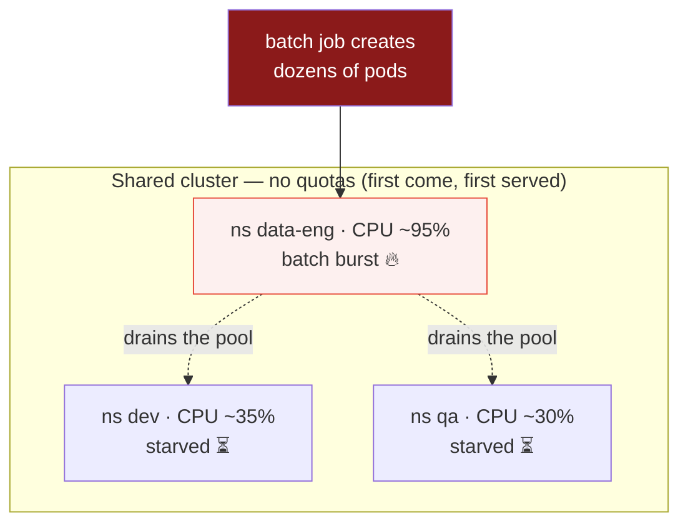
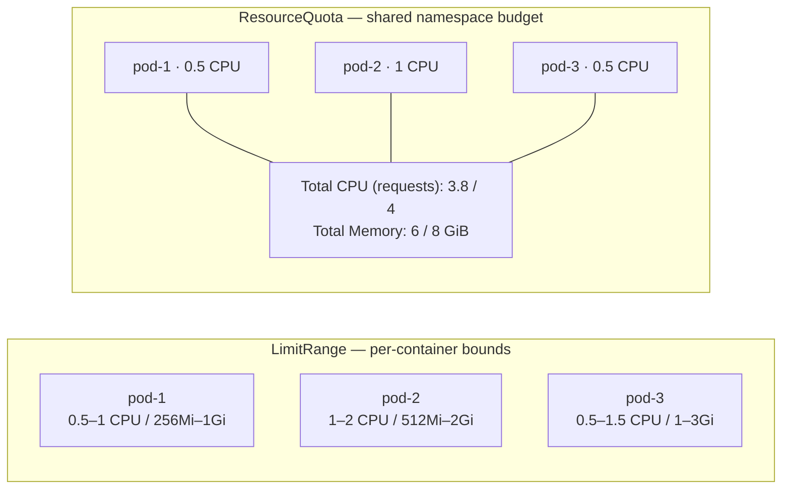
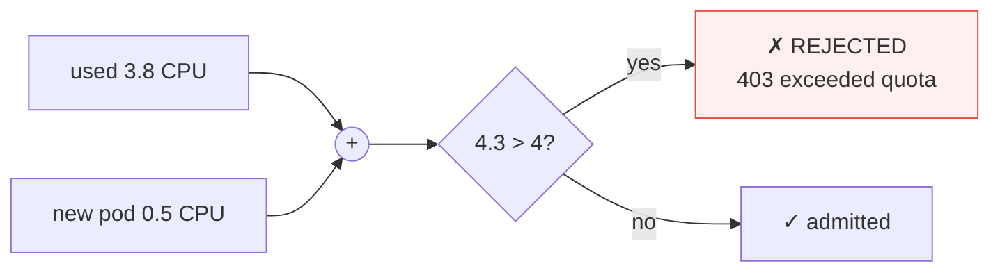
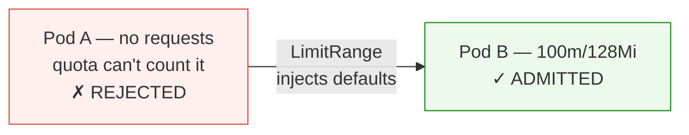
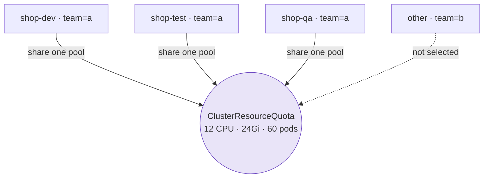

# ResourceQuota Controls — Namespace Resource Governance on OpenShift

| Field | Detail |
|---|---|
| **Document status** | **DOCUMENTED** — reference/procedure guide, tested on the lab cluster |
| **Cluster** | lab.ocp.local — OpenShift 4.20.35, 3 control-plane + 2 worker nodes (dev/test) |
| **Category** | Namespace governance / multi-tenancy / capacity management |
| **Audience** | OCP administrators, platform engineers, GitOps operators |
| **Related** | Namespace onboarding automation, LimitRange defaults, ClusterResourceQuota (multi-project) |

> 📄 Companion visual doc: [`ResourceQuota-Controls-Guide.html`](ResourceQuota-Controls-Guide.html) — same content with flat infographic-style diagrams.

---

## 0. Interview Snapshot — The 60-Second Story

> *"We ran a shared cluster across three teams — dev, QA, and data engineering. One afternoon
> the data team fired off a batch job: dozens of pods, each perfectly reasonable on its own.
> Individually fine. Collectively, they starved the cluster — dev deploys stalled, QA workloads
> queued, and nothing in any single pod spec looked wrong.*
>
> *The real gap: there was no boundary on how much of the shared pool one namespace could take.
> I fixed it with ResourceQuota — a hard budget per namespace on CPU, memory, and object counts —
> paired with LimitRange defaults so pods without declared requests stopped failing admission.
> Then I codified it: quota + limitrange + network policy + RBAC all provisioned together via
> ArgoCD during namespace onboarding — no tickets, no drift.*
>
> *Result: the noisy-neighbor failure mode disappeared, and onboarding went from hours to minutes."*

**Quotable lines worth stealing:**

- "A quota is a budget per namespace — not a promise of capacity."
- "LimitRange cares about each pod's bounds; ResourceQuota cares about the sum of everything."
- "Deployment accepted but no pods? Check the ReplicaSet events — the quota error lives there."
- "It's the family data plan: every member gets an allowance, but the plan itself has a ceiling."

**If asked for a one-liner:** *"On a shared cluster, quota is the bulkhead — one team can never
sink the others."*

---

## 1. When Every Pod Looks Fine, but the Cluster Starts Struggling

Imagine a cluster shared by three teams: **development**, **QA**, and **data engineering**.
Everything looks fine — each team deploys apps, sets CPU/memory limits, follows the guidelines.

Then, one afternoon, the data team starts a batch job. Dozens of pods — each reasonable on its
own — together consume a significant share of the cluster. Dev's new pods sit waiting; QA's
workloads take longer to start.

**The problem isn't any one pod — it's that nobody set a limit on how much the entire data
namespace could consume.**



---

## 2. The Budget Idea

Instead of looking at consumption one pod at a time, **ResourceQuota** defines a **budget for the
whole namespace**. Once that budget is reached, Kubernetes prevents additional usage that would
exceed it.

Think of it as giving every team its own allowance, rather than letting everyone draw from the
shared pool without a defined limit.

> **Key detail:** quota counts **requests** (and limits) — the pod's reservation, not real usage.
> A pod requesting 1 CPU counts 1 CPU even while idling at 10m.

---

## 3. First, Understand the Difference: LimitRange vs ResourceQuota

The two sound similar but solve different problems:

- **LimitRange** controls resources assigned to **individual** containers — defaults, min, max.
- **ResourceQuota** controls the **total** usage of selected resources or objects **per namespace**.

**The family-plan analogy:** each family member has an individual data allowance (LimitRange).
The family also has a total monthly plan (ResourceQuota). The two complement each other.



### Feature-by-feature

| Feature | LimitRange | ResourceQuota |
|---|---|---|
| **Main purpose** | Defaults & boundaries for individual resources | Limits **total** usage within a namespace |
| **Scope** | Individual containers / supported types | Entire namespace |
| **CPU & memory** | min / max / defaults per container | Aggregate requests and limits |
| **Object counts** | Not its purpose | Pods, Services, PVCs, `count/<resource>.<group>` — anything |
| **Example** | "A container's memory limit must not exceed 2 GiB" | "Namespace memory requests must not exceed 8 GiB" |

---

## 4. Create Your First ResourceQuota

For namespace `dev` — a CPU/memory budget plus object-count caps (`quota.yaml`):

```yaml
apiVersion: v1
kind: ResourceQuota
metadata:
  name: dev-team-quota
  namespace: dev
spec:
  hard:
    requests.cpu: "4"        # sum of pod CPU requests
    requests.memory: "8Gi"   # sum of pod memory requests
    limits.cpu: "8"          # sum of pod CPU limits
    limits.memory: "16Gi"    # sum of pod memory limits
    pods: "20"
    services: "5"
    persistentvolumeclaims: "10"
    configmaps: "20"
    secrets: "20"
```

- `metadata` pins the quota to namespace `dev`; `spec.hard` lists the ceilings.
- **requests** = what pods ask to reserve; **limits** = the max they're allowed to use — different
  measurements serving different purposes.
- ⚠️ A quota is **not** a promise of capacity — the cluster must still have the room.

---

## 5. Apply the Quota

```bash
oc create namespace dev        # skip if it exists (kubectl identical)
oc apply -f quota.yaml
```

That's it — the namespace now has an enforced budget.

---

## 6. Check How Much of the Quota Is Used

```bash
oc describe resourcequota dev-team-quota -n dev   # Used vs Hard per resource
oc get resourcequota -n dev                        # list quotas
oc get events -n dev --sort-by=.lastTimestamp      # recent quota errors
```

If `requests.cpu` shows `Used: 1500m` against `Hard: 4` → 1.5 CPUs consumed, **2.5 CPUs headroom**.

> **Practical tip:** when a deployment suddenly stops creating pods, check quota usage first —
> the namespace may simply have hit its budget.

---

## 7. What Happens When the Quota Is Reached?

Namespace budget: `requests.cpu: "4"`. Already used: **3.8**. New pod asks **500m**:

```
3.8 used + 0.5 new = 4.3 > 4 hard  →  403 Forbidden: exceeded quota: dev-team-quota
```

The **cluster** didn't run out of CPU — the **namespace** ran out of budget. On shared clusters,
that distinction is everything.



---

## 8. What If the Pod Belongs to a Deployment?

The confusing case: you apply a Deployment — Kubernetes **accepts it** — but pods never appear.

A Deployment manages ReplicaSets, which create Pods. **The Deployment object itself doesn't
consume quota** — only pods do. So it exists happily while its ReplicaSet keeps failing below.

```
Deployment ✓ accepted  →  ReplicaSet ✓ created  →  Pods ✗ blocked (exceeded quota)
```

```bash
oc describe replicaset <rs-name> -n dev   # the quota error lives HERE
oc get events -n dev --sort-by=.lastTimestamp
```

Then: reduce requests, remove unneeded workloads, or raise the quota (with approval).

---

## 9. One Common Gotcha: Missing CPU or Memory Requests

If a quota tracks `requests.cpu`/`memory`, a pod that **doesn't declare them can't be counted** —
so it's rejected. Same for tracked limits.

This is why the pair ship together — LimitRange supplies defaults (`limitrange.yaml`):

```yaml
apiVersion: v1
kind: LimitRange
metadata:
  name: default-container-resources
  namespace: dev
spec:
  limits:
    - type: Container
      defaultRequest: { cpu: "100m", memory: "128Mi" }   # injected when omitted
      default:        { cpu: "500m", memory: "512Mi" }
```

```bash
oc apply -f limitrange.yaml
```



Defaults apply at **admission** — they don't rewrite existing pods.

---

## 10. ResourceQuota Isn't a Replacement for Capacity Planning

Three distinct outcomes — don't confuse them:

| Situation | Result |
|---|---|
| Within quota + nodes have room | ✓ pod schedules and runs |
| Within quota, but no node fits | ⏳ pod stays **Pending** — a *scheduling* issue, not quota |
| Would exceed quota | ✗ rejected at admission — `403 exceeded quota` |

Quota is one part of the strategy — good requests, sensible limits, capacity planning, and
workload monitoring still matter.

---

## 11. OpenShift Extras — ClusterResourceQuota & Scopes

OCP adds **ClusterResourceQuota** (CRQ): one shared pool across **many** projects selected by
namespace label — "team A gets 12 CPU across dev, test, qa."

```yaml
apiVersion: quota.openshift.io/v1
kind: ClusterResourceQuota
metadata:
  name: team-a-aggregate
spec:
  selector:
    labels:
      team: a                      # every project labeled team=a shares ONE pool
  quota:
    hard:
      requests.cpu: "12"
      requests.memory: 24Gi
      pods: "60"
```



- Selection via `spec.selector.labels` or the `openshift.io/quota: <name>` annotation.
- CRQ usage syncs **slowly by design** (~minutes) — not for instantaneous enforcement.
- A namespace may be selected by only **one** CRQ.
- Never quota `openshift-*`, `kube-*`, `default`.
- The **Project Request Template** can inject quota+limitrange into every new project — quotas become default-on.
- Inspect: `oc describe clusterquota <name>`.

### Scopes — quotas that apply only to matching pods

| Scope | Selects pods that are… | Typical use |
|---|---|---|
| `BestEffort` | no requests/limits at all | `hard: pods: "0"` bans unbounded pods outright |
| `NotBestEffort` | have ≥1 request/limit | Normal compute quotas |
| `Terminating` | have `activeDeadlineSeconds` | Reserve room for jobs |
| `NotTerminating` | long-running | Default workloads |
| `PriorityClass` | listed `priorityClassName` | Bigger slice for prod than dev |

### Full quota matrix

| Bucket | Keys | Protects |
|---|---|---|
| Compute | `requests.cpu`, `requests.memory`, `limits.cpu`, `limits.memory` | Nodes |
| Storage | `requests.storage`, `persistentvolumeclaims`, `<class>.storageclass.storage.k8s.io/requests.storage` | Nodes / storage |
| Objects | `pods`, `services`, `services.loadbalancers`, `services.nodeports`, `secrets`, `configmaps`, `deployments.apps`, `jobs.batch`, `cronjobs.batch`, `count/<resource>.<group>` | etcd / API server |

---

## 12. Before Using ResourceQuota in Production

- [ ] Every user namespace gets **both** ResourceQuota *and* LimitRange (project template or GitOps).
- [ ] `scopes: [BestEffort]` + `pods: "0"` — or LimitRange defaults — prevents unbounded pods.
- [ ] Object-count quotas on `configmaps`, `secrets`, `services` — they protect etcd, not nodes.
- [ ] `services.loadbalancers` / `nodeports` pinned to `0` where not needed.
- [ ] ClusterResourceQuota for team pools; per-namespace ResourceQuota for hard walls.
- [ ] Audit usage at `used / hard > 80%` — run [`scripts/quota-audit.sh`](scripts/quota-audit.sh).
- [ ] Roll quota + limitrange + namespace via GitOps in one Application — quota *is* policy.
- [ ] Remember `status.used` can lag ~5 min (`resource-quota-sync-period`).

---

## 13. The Takeaway: Give Every Namespace a Budget

The problem was never "too many pods" — it was the absence of a boundary on how much of the
shared environment one namespace could consume. ResourceQuota introduces that boundary;
LimitRange keeps individual workloads sane inside it.

Start with a namespace you know well, set a realistic budget, observe, and adjust from real
usage — not guesses.

> **Deployment broken? Check the quota first:** `oc describe quota -n <ns>` — the fix is often
> right-sizing requests, cleanup, or an approved quota raise.

---

## Files in This Issue

| File | Purpose |
|---|---|
| [`README.md`](README.md) | Issue summary + quick-fix table |
| `ResourceQuota-Controls-Guide.md` | This document — full reference with diagrams |
| [`ResourceQuota-Controls-Guide.html`](ResourceQuota-Controls-Guide.html) | Rendered standalone HTML version (flat infographic diagrams) |
| [`manifests/resourcequota-compute.yaml`](manifests/resourcequota-compute.yaml) | Standard compute+object quota |
| [`manifests/limitrange-defaults.yaml`](manifests/limitrange-defaults.yaml) | Matching LimitRange defaults/min/max |
| [`manifests/clusterresourcequota.yaml`](manifests/clusterresourcequota.yaml) | OCP multi-project quota example |
| [`manifests/quota-scopes-besteffort-ban.yaml`](manifests/quota-scopes-besteffort-ban.yaml) | Ban BestEffort pods via scopes |
| [`scripts/quota-audit.sh`](scripts/quota-audit.sh) | Read-only audit: list quotas + % used, flag ≥ 80% |
