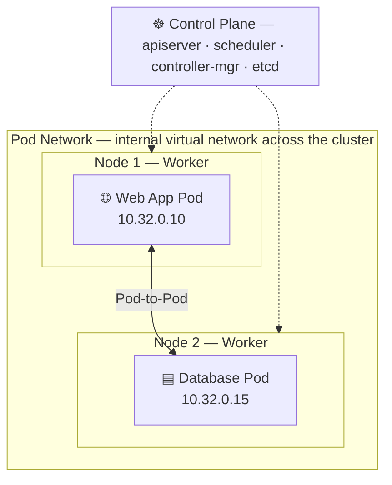
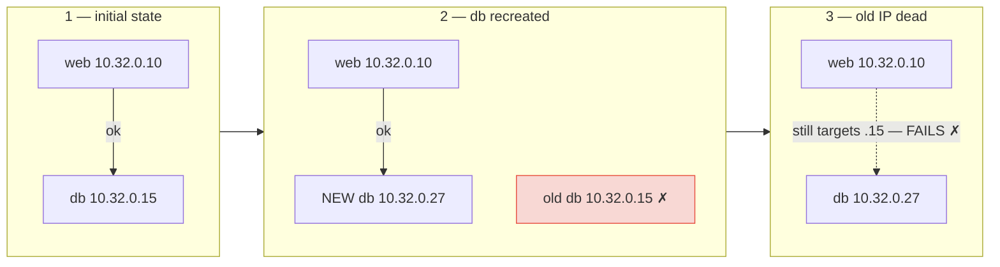
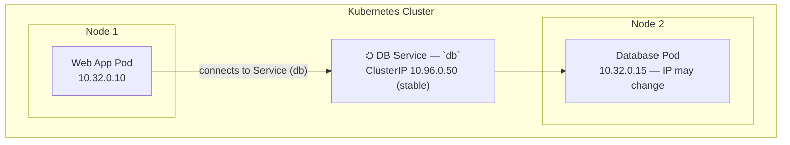
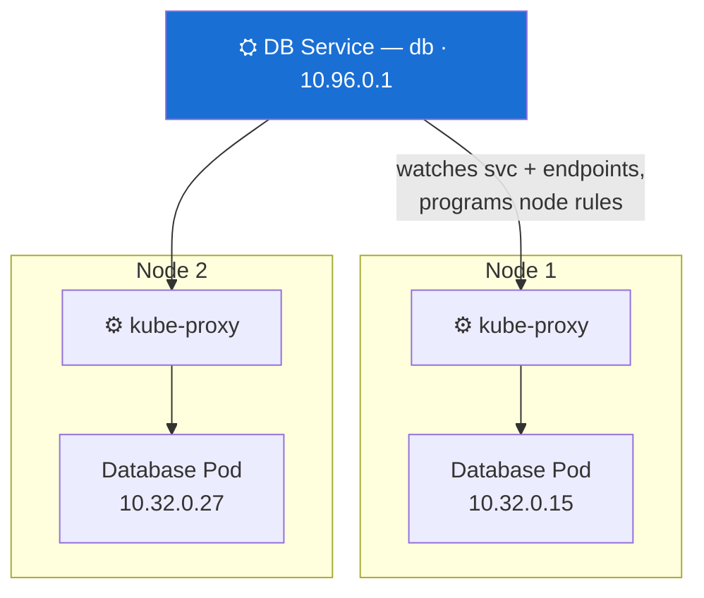
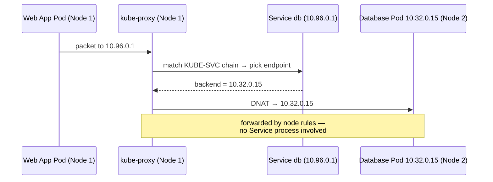
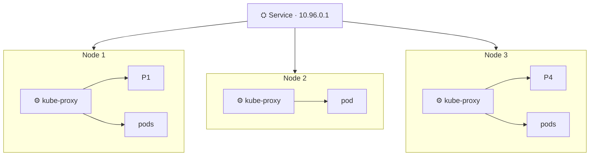
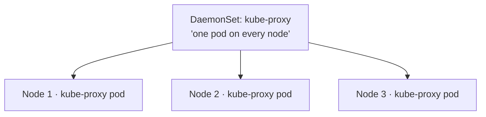

# Kube-Proxy in Kubernetes — How Service Traffic Finds the Right Pod

| Field | Detail |
|---|---|
| **Document status** | **DOCUMENTED** — concept/reference guide |
| **Cluster** | lab.ocp.local — OpenShift 4.20.35 (OVN-Kubernetes) |
| **Category** | Kubernetes networking — Services & node-level routing |
| **Audience** | OCP/K8s administrators, platform engineers |

> 📄 Companion visual doc: [`Kube-Proxy-Guide.html`](Kube-Proxy-Guide.html) — same content with flat infographic-style diagrams.

---

## 0. Interview Snapshot — The 60-Second Story

> *"Pod IPs are ephemeral — recreate a pod and it comes back with a different address, so
> hard-coding pod IPs between apps breaks on every rollout. A Kubernetes Service fixes that with
> a stable IP and DNS name. But here's the part people miss: **the Service isn't a process** —
> nothing listens on that IP. The actual forwarding is done by **kube-proxy**, which runs on
> every node and programs iptables/IPVS rules so traffic to the Service IP lands on a healthy
> backend pod. Service = stable address; kube-proxy = the plumbing that makes the address real."*

**Quotable lines worth stealing:**

- "The Service is just an API object — **kube-proxy makes its IP real** on every node."
- "Pod IPs are like hotel room numbers — fine for a stay, useless as a home address."
- "Traffic never hits a Service 'process' — iptables rewrites it to a pod before it leaves the node."
- "kube-proxy is a DaemonSet because the routing table has to exist **wherever traffic originates**."

**One-liner:** *"The Service is the stable address on the envelope — kube-proxy is the post
office on every node that actually delivers it."*

---

## 1. Pod Networking — Every Pod Can Reach Every Pod

First rule of Kubernetes networking: **every Pod should be able to communicate with every other
Pod**, even across nodes. The Pod network provides an internal virtual network spanning the
whole cluster.

A web app on Node 1 (`10.32.0.10`) can reach a database on Node 2 (`10.32.0.15`) — directly,
by pod IP.



---

## 2. But Pod IP Addresses Are Not Permanent

A pod is not a permanent server. Recreate it — the new pod gets a **different IP**. If the web
app hard-coded `10.32.0.15`, it breaks the moment the database pod is recreated:



> ⚠️ Relying on Pod IPs directly is not reliable. This is why **Services** exist.

---

## 3. Using a Service Instead of the Pod IP

Create a **Service** for the database. The app connects to the name `db` — a stable ClusterIP
and DNS name that survives every recreate:



| Approach | On pod recreate |
|---|---|
| Direct Pod IP | ✗ app breaks — old IP dead |
| Via Service | ✓ app never notices — Service IP stays |

---

## 4. So Where Does the Service Actually Run?

A Service has an IP — `10.96.0.50`. Does it join the pod network? Run as a container?

> **No — and this is the important concept.** A Service is **not a pod, not a container, not a
> process**. It's a *virtual component* — an API object inside the Kubernetes system. Nothing
> "sits" on `10.96.0.50`.

So how does traffic to that IP reach a backend pod? → **kube-proxy**.

---

## 5. What Is kube-proxy?

**kube-proxy is a process that runs on every node.** It watches the API server for Service and
EndpointSlice changes, then configures the node's networking so traffic to a Service IP reaches
the right backend pods — via **iptables** or **IPVS** rules.



| kube-proxy responsibility | Detail |
|---|---|
| Runs on every node | DaemonSet in `kube-system` (upstream) / platform-managed on OCP |
| Watches the API server | Service & EndpointSlice changes trigger rule updates |
| Programs node rules | iptables / IPVS: Service IP → backend pods |
| Routes + load balances | Forwards to one healthy backend pod |

---

## 6. How kube-proxy Forwards Service Traffic

Service `db` = `10.96.0.1`; backend pod = `10.32.0.15`. When the web app sends to `10.96.0.1`:



```bash
# Example iptables rules (simplified)
# Traffic to Service IP 10.96.0.1 is redirected to backend Pod 10.32.0.15
iptables -t nat -A KUBE-SVC-xxxxx -d 10.96.0.1 -j KUBE-SEP-yyyyy
iptables -t nat -A KUBE-SEP-yyyyy -j DNAT --to-destination 10.32.0.15
```

---

## 7. Why Does kube-proxy Run on Every Node?

Because Service traffic can originate on **any** node — each node needs the routing rules
**locally**:



When Services change, each node's kube-proxy syncs its own rules — the Service is reachable
regardless of where the request starts.

---

## 8. Installing kube-proxy — Two Paths

**Manual (bare binary):**

```bash
VERSION="v1.36.5"
curl -LO https://dl.k8s.io/${VERSION}/bin/linux/amd64/kube-proxy
chmod +x kube-proxy && sudo mv kube-proxy /usr/local/bin/
sudo useradd --system --no-create-home --shell /usr/sbin/nologin kube-proxy
sudo mkdir -p /var/lib/kube-proxy /etc/kubernetes
# write config.yaml + proxy.conf kubeconfig, then:
sudo systemctl daemon-reload
sudo systemctl enable --now kube-proxy
sudo journalctl -u kube-proxy -f
```

**kubeadm / installers:** kube-proxy ships as a **DaemonSet** — one kube-proxy pod per node,
scheduled automatically (new nodes get it for free).



---

## 9. Putting It All Together

| # | Step | What happens |
|---|---|---|
| 1 | Pod network | Pods can reach each other by Pod IP across nodes |
| 2 | Client uses Service | Stable ClusterIP / DNS instead of an ephemeral pod IP |
| 3 | Traffic hits the node | Request to Service IP reaches kube-proxy's rules |
| 4 | kube-proxy routes | iptables/IPVS rewrite → one healthy backend pod |
| 5 | Pod responds | Traffic lands on the backend (e.g. `10.32.0.15`) |
| 6 | Load balancing | Spread across all healthy endpoints — auto-heals on recreate |

```bash
# see it live
kubectl get pods -n kube-system -o wide | grep kube-proxy                    # upstream
oc get pods -n openshift-ovn-kubernetes -o wide | grep ovnkube-node          # OCP
```

---

## 10. OpenShift Note — OVN-Kubernetes Replaces kube-proxy

On **OpenShift 4.x with OVN-Kubernetes** (the default CNI — what lab.ocp.local runs), there is
**no classic kube-proxy**. Service routing is programmed by **OVN**: the `ovnkube-node`
DaemonSet installs OVS/OpenFlow rules that do the same Service IP → endpoint NAT job.
Same mental model, different plumbing.

| Upstream Kubernetes | OpenShift (OVN-Kubernetes) |
|---|---|
| kube-proxy DaemonSet, `kube-system` | `ovnkube-node` DaemonSet, `openshift-ovn-kubernetes` |
| iptables / IPVS rules | OVS / OpenFlow flows via ovnkube |
| `kubectl get pods -n kube-system` | `oc get pods -n openshift-ovn-kubernetes` |

(On a legacy `OpenShiftSDN` cluster, `sdn` pods play the kube-proxy-equivalent role.)

---

## 11. The Takeaway

- The **Pod network** gives every pod reachability.
- A **Service** gives apps a stable IP and DNS name immune to pod recreates — but it's only an
  API object, not a process.
- **kube-proxy**, on every node, is the plumbing that rewrites Service traffic onto real backend
  pods.

> **Service = the address; kube-proxy = the routing.**
> Try it: `oc get svc` → `oc get endpointslices` → inspect the node's NAT rules/OVN flows.
> Watching a packet get DNAT'd from Service IP to pod IP makes this click instantly.
