# Kubernetes Ingress — Simple Guide (with Diagrams)

---

## 1. Where Ingress Fits

| Building block | What it does |
|---|---|
| **Pod** | Runs your app container |
| **Deployment** | Keeps N pods running, handles scaling & rollouts |
| **Service** | Gives pods a stable internal address (L4) |
| **Ingress** | Routes outside HTTP/HTTPS traffic to Services by **domain** or **path** (L7) |

**Problems Ingress solves**

- Route by domain (`app.example.com`) or URL path (`/api`)
- HTTPS (TLS) in one place
- Many services behind **one** public IP / LoadBalancer (saves cost)

**Colour key used in every diagram:**


> **Think of Ingress as a smart receptionist at the front door of your cluster** — it reads the address on each request and sends it to the right room.

---

## 2. Ingress vs Ingress Controller (Important!)

An **Ingress** is just a set of rules (YAML). It does **nothing by itself**.
An **Ingress Controller** is the actual proxy (a pod) that reads those rules and moves the traffic.

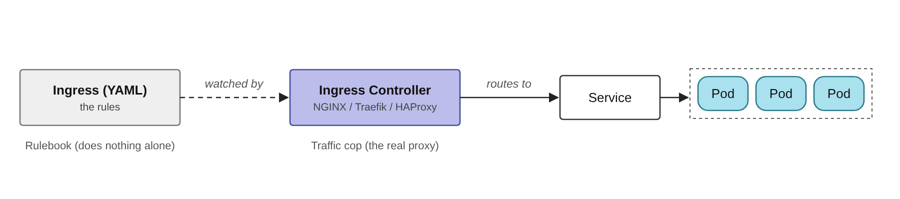

| Ingress (resource) | Ingress Controller |
|---|---|
| The **rulebook** | The **traffic cop** |
| `kind: Ingress` YAML | A Deployment running NGINX/Traefik/HAProxy |
| Stored in the API server | Runs as pods, exposed by a LoadBalancer Service |

---

## 3. How a Request Flows (Step by Step)

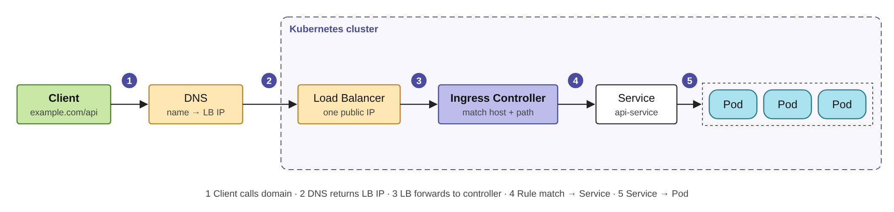

1. User opens `example.com`
2. DNS resolves it to the LoadBalancer IP
3. LoadBalancer forwards to the Ingress Controller
4. Controller matches the **host** and **path** rules
5. Request goes to the matching **Service**
6. Service load-balances to a **Pod**

---

## 4. Routing Pattern 1 — Host-Based Routing

**Different domains → different services** (same IP).

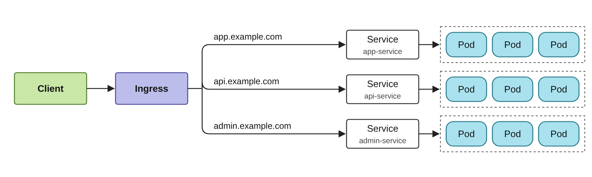

```yaml
apiVersion: networking.k8s.io/v1
kind: Ingress
metadata:
  name: host-based-ingress
spec:
  ingressClassName: nginx
  rules:
    - host: app.example.com
      http:
        paths:
          - path: /
            pathType: Prefix
            backend:
              service:
                name: app-service
                port:
                  number: 80
    - host: api.example.com
      http:
        paths:
          - path: /
            pathType: Prefix
            backend:
              service:
                name: api-service
                port:
                  number: 80
```

**Use when:** each team/product has its own sub-domain.

---

## 5. Routing Pattern 2 — Path-Based Routing

**Same domain, different URL paths → different services.**

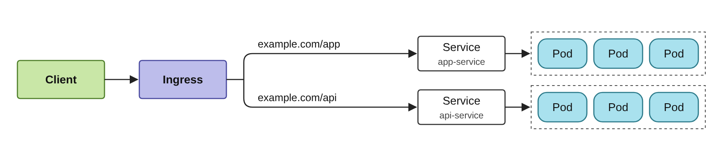

```yaml
apiVersion: networking.k8s.io/v1
kind: Ingress
metadata:
  name: path-based-ingress
spec:
  ingressClassName: nginx
  rules:
    - host: example.com
      http:
        paths:
          - path: /app
            pathType: Prefix
            backend:
              service:
                name: app-service
                port:
                  number: 80
          - path: /api
            pathType: Prefix
            backend:
              service:
                name: api-service
                port:
                  number: 80
```

**`pathType` cheat sheet**

| pathType | `/api` matches | Notes |
|---|---|---|
| `Prefix` | `/api`, `/api/`, `/api/users` | Most common |
| `Exact` | only `/api` | Strict match |
| `ImplementationSpecific` | depends on controller | Avoid unless needed |

> Longest matching path wins — `/api/v2` beats `/api` beats `/`.

---

## 5b. Host + Path Combined

One Ingress can mix both: some rules match a domain **plus** a path, others just a domain.

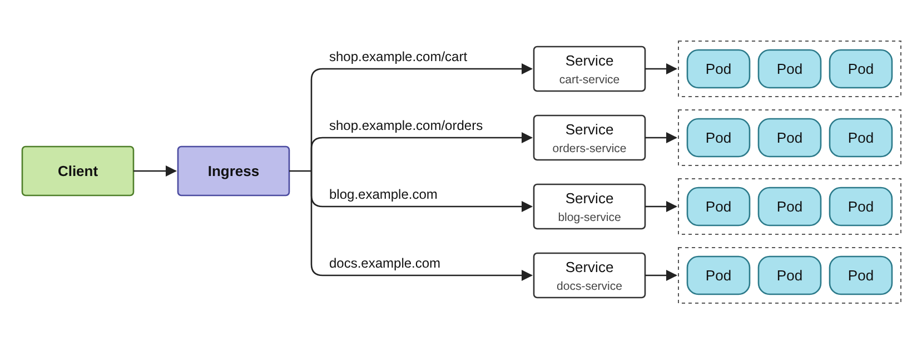

```yaml
spec:
  ingressClassName: nginx
  rules:
    - host: shop.example.com
      http:
        paths:
          - path: /cart
            pathType: Prefix
            backend: { service: { name: cart-service, port: { number: 80 } } }
          - path: /orders
            pathType: Prefix
            backend: { service: { name: orders-service, port: { number: 80 } } }
    - host: blog.example.com
      http:
        paths:
          - path: /
            pathType: Prefix
            backend: { service: { name: blog-service, port: { number: 80 } } }
    - host: docs.example.com
      http:
        paths:
          - path: /
            pathType: Prefix
            backend: { service: { name: docs-service, port: { number: 80 } } }
```

---

## 6. Enabling HTTPS with TLS

The controller **terminates TLS**: browser ↔ controller is encrypted (HTTPS), controller ↔ pods is usually plain HTTP inside the cluster.

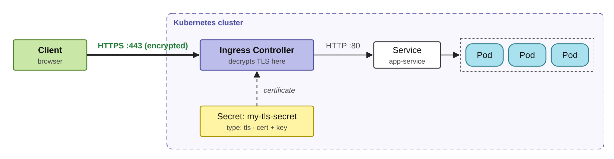

**Step 1 — Create the TLS secret**

```bash
kubectl create secret tls my-tls-secret \
  --cert=cert.crt \
  --key=key.key
```

**Step 2 — Reference it in the Ingress**

```yaml
apiVersion: networking.k8s.io/v1
kind: Ingress
metadata:
  name: secure-ingress
spec:
  ingressClassName: nginx
  tls:
    - hosts:
        - example.com
      secretName: my-tls-secret
  rules:
    - host: example.com
      http:
        paths:
          - path: /
            pathType: Prefix
            backend:
              service:
                name: app-service
                port:
                  number: 80
```

> **Production tip:** use **cert-manager** + Let's Encrypt to issue and auto-renew certificates instead of creating secrets by hand.

---

## 7. Installing the Ingress Controller (NGINX)

```bash
helm repo add ingress-nginx https://kubernetes.github.io/ingress-nginx
helm repo update
helm install ingress-nginx ingress-nginx/ingress-nginx \
  --namespace ingress-nginx --create-namespace

# Get the public IP / hostname to point your DNS at
kubectl get svc -n ingress-nginx ingress-nginx-controller
```

---

## 8. Full Production Example (Microservices)

**Scenario:** `example.com` → frontend, `example.com/api` → backend, all over HTTPS.

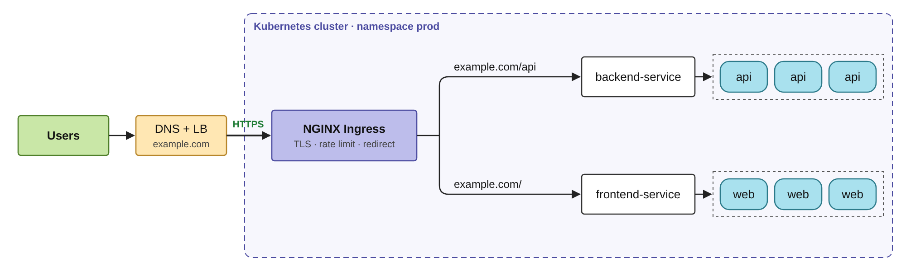

```yaml
apiVersion: networking.k8s.io/v1
kind: Ingress
metadata:
  name: prod-ingress
  annotations:
    nginx.ingress.kubernetes.io/ssl-redirect: "true"
    nginx.ingress.kubernetes.io/limit-rps: "10"
spec:
  ingressClassName: nginx
  tls:
    - hosts: [example.com]
      secretName: example-com-tls
  rules:
    - host: example.com
      http:
        paths:
          - path: /api
            pathType: Prefix
            backend:
              service:
                name: backend-service
                port:
                  number: 80
          - path: /
            pathType: Prefix
            backend:
              service:
                name: frontend-service
                port:
                  number: 80
```

---

## 9. Advanced Features (NGINX annotations)

### 9.1 Rewrite Target

Strip a prefix before the request reaches the backend.

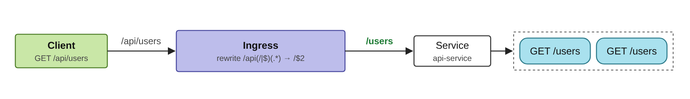

```yaml
metadata:
  annotations:
    nginx.ingress.kubernetes.io/use-regex: "true"
    nginx.ingress.kubernetes.io/rewrite-target: /$2
spec:
  rules:
    - host: example.com
      http:
        paths:
          - path: /api(/|$)(.*)
            pathType: ImplementationSpecific
            backend:
              service:
                name: api-service
                port:
                  number: 80
```

> A plain `rewrite-target: /` sends **every** request to `/`. Use capture groups (above) to keep the rest of the path.

### 9.2 Rate Limiting

```yaml
nginx.ingress.kubernetes.io/limit-rps: "10"   # max 10 requests/sec per client IP
```

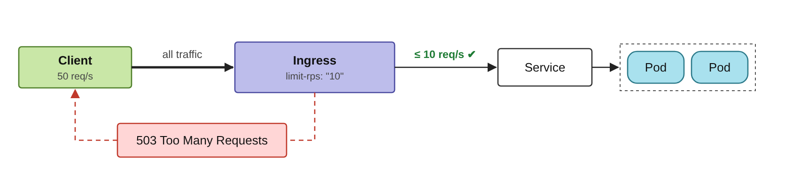

### 9.3 Authentication

- **Basic Auth** — username/password from a Secret

```yaml
nginx.ingress.kubernetes.io/auth-type: basic
nginx.ingress.kubernetes.io/auth-secret: basic-auth
nginx.ingress.kubernetes.io/auth-realm: "Authentication Required"
```

- **OAuth / SSO** — send users to an external auth service (e.g. oauth2-proxy)

```yaml
nginx.ingress.kubernetes.io/auth-url: "https://auth.example.com/oauth2/auth"
nginx.ingress.kubernetes.io/auth-signin: "https://auth.example.com/oauth2/start"
```

### 9.4 Canary Deployments

Send a small % of traffic to the new version; increase it as confidence grows.

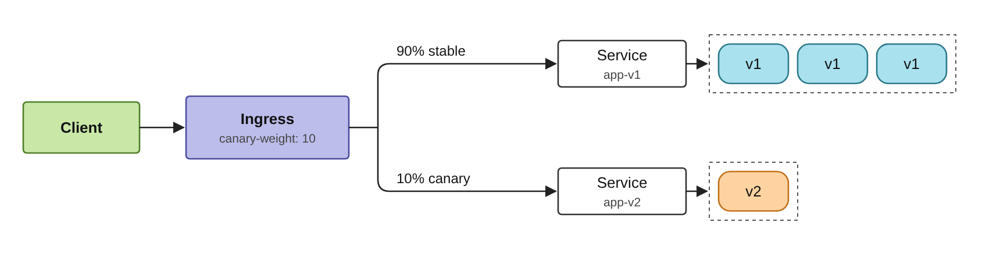

Create a **second** Ingress for the same host/path, marked as canary:

```yaml
apiVersion: networking.k8s.io/v1
kind: Ingress
metadata:
  name: app-canary
  annotations:
    nginx.ingress.kubernetes.io/canary: "true"
    nginx.ingress.kubernetes.io/canary-weight: "10"
spec:
  ingressClassName: nginx
  rules:
    - host: example.com
      http:
        paths:
          - path: /
            pathType: Prefix
            backend:
              service:
                name: app-v2
                port:
                  number: 80
```

---

## 10. Service vs Ingress

| Feature | Service (LoadBalancer/NodePort) | Ingress |
|---|---|---|
| OSI Layer | L4 (TCP/UDP) | L7 (HTTP/HTTPS) |
| Routing | Basic (port → pods) | Advanced (host, path, headers) |
| SSL/TLS termination | ❌ | ✅ |
| Domain-based routing | ❌ | ✅ |
| Public IPs needed | One per service | **One for all** |
| Cost | Higher (many LBs) | Lower (one LB) |

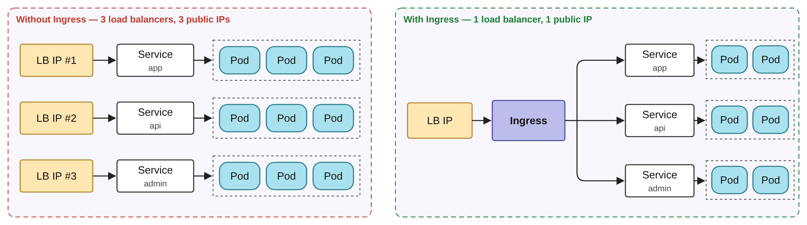

---

## 11. Production Checklist

- ✅ Set `ingressClassName` explicitly (avoid ambiguity with multiple controllers)
- ✅ Use cert-manager for automatic TLS; force HTTPS redirect
- ✅ Run 2+ controller replicas with a PodDisruptionBudget
- ✅ Add rate limits & auth on sensitive paths
- ✅ Order paths from most specific to least (`/api/v2`, `/api`, `/`)
- ✅ Monitor controller metrics (Prometheus) and access logs
- ℹ️ For new projects, also look at **Gateway API** — the successor to Ingress

## 12. Handy Commands

```bash
kubectl get ingress -A                      # list all ingresses
kubectl describe ingress prod-ingress       # see rules, backends, events
kubectl get ingressclass                    # which controllers exist
kubectl logs -n ingress-nginx deploy/ingress-nginx-controller   # controller logs
curl -H "Host: example.com" http://<LB-IP>/api   # test before DNS is ready
```

---

## 🏁 Summary

**Ingress = the gateway to your cluster.**
One IP → smart routing by host/path → HTTPS in one place → canary, auth, rate limits on top.
