# What happens when you deploy — the full flow, step by step

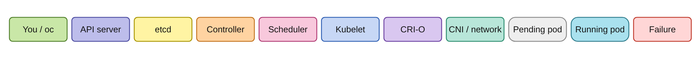

---

## The restaurant analogy

Think of it like placing an order at a restaurant: you tell the **front desk** (API server), the order gets **written down** (etcd), the **kitchen manager** (controller) breaks it into tasks, a **host** assigns a table (scheduler), and a **waiter** actually serves it (kubelet).

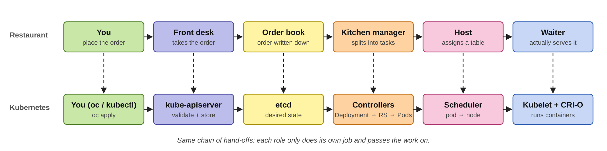

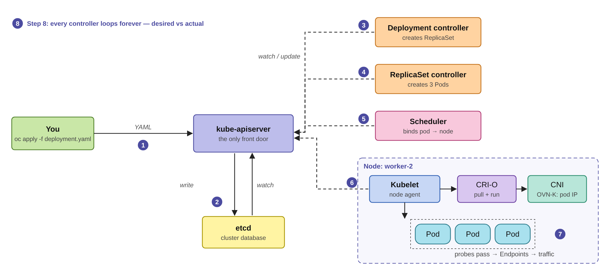

---

## Step 1 — You submit the request

`oc` / `kubectl` sends the Deployment YAML to the API server (**kube-apiserver**). This is the only component you ever talk to — everything else reacts to it.

```bash
oc apply -f deployment.yaml     # or oc create deployment / helm install
```

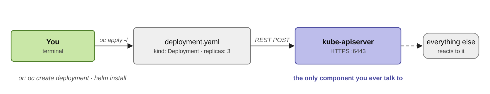

---

## Step 2 — API server validates and stores

The API server:

- **Authenticates** you (who are you?) and **authorizes** you (can you create deployments? via RBAC)
- **Validates** the YAML against the schema (wrong field? rejected here)
- Runs **admission webhooks** (OpenShift's SCC / SecurityContextConstraints inject things like the user ID the container must run as)
- **Writes the object to etcd** — the cluster's database. Only now does the Deployment "exist"

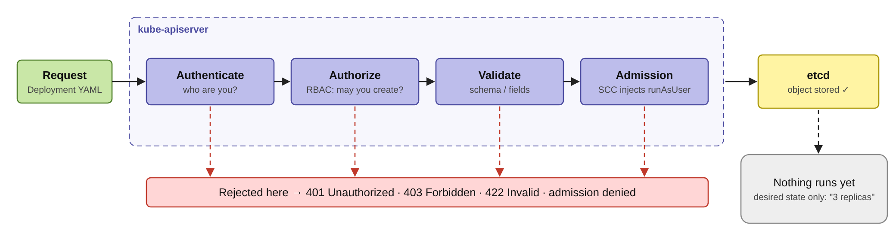

> **Important:** Nothing is running yet. It's just a desired state written in etcd — "I want 3 replicas of this image."

---

## Step 3 — Deployment controller reacts

The **controller manager** has dozens of controllers watching the API server for changes. The **Deployment controller** sees the new Deployment and creates a **ReplicaSet** object with `replicas: 3` and your pod template.

---

## Step 4 — ReplicaSet controller creates Pods

The **ReplicaSet controller** sees "3 desired, 0 exist" and creates 3 **Pod** objects in etcd. Pods get names like `myapp-7d9f4b8c6-x2vkl`. At this point each pod is `Pending` with `spec.nodeName` empty.

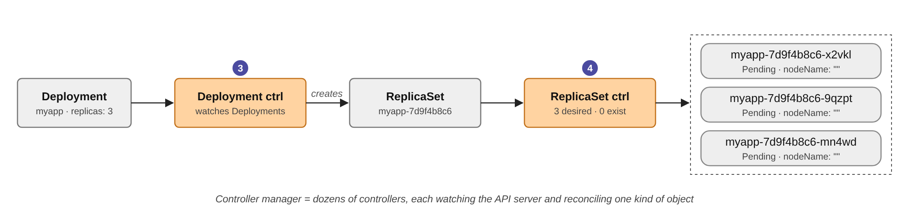

---

## Step 5 — Scheduler picks a node

The **scheduler** watches for pods with no node assigned. For each pod it:

- **Filters** nodes: enough CPU/memory? right labels/taints? `NotReady` nodes are excluded — this is exactly why pods were stuck on the lab cluster: only 2 Ready nodes
- **Scores** the remaining nodes (spread across zones/nodes, locality, etc.)
- Writes `spec.nodeName: worker-2` — this is the **binding**

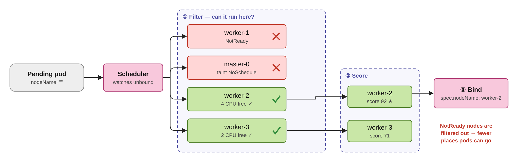

---

## Step 6 — Kubelet takes over on the node

The **kubelet** on the chosen node sees a pod assigned to it:

- **Pulls the image** via **CRI-O** (the container runtime): `crio` → registry → image layers stored locally
- Asks CRI-O to create the **pod sandbox + containers**
- **Mounts volumes**, injects ConfigMaps / Secrets / Services env vars
- **Runs the entrypoint** → container starts

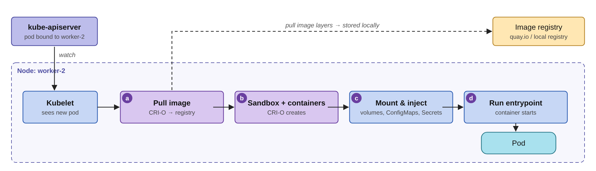

---

## Step 7 — Health checks & networking

- **Startup / readiness / liveness probes** run — readiness must pass before the pod gets traffic
- **CNI plugin** (OVN-Kubernetes on OCP) gave the pod its IP at sandbox creation
- Once Ready, the **Endpoints / EndpointSlice controller** adds the pod's IP to the Service's endpoint list → traffic flows
- Kubelet **reports status** back to the API server → `kubectl get pods` shows `Running 1/1`

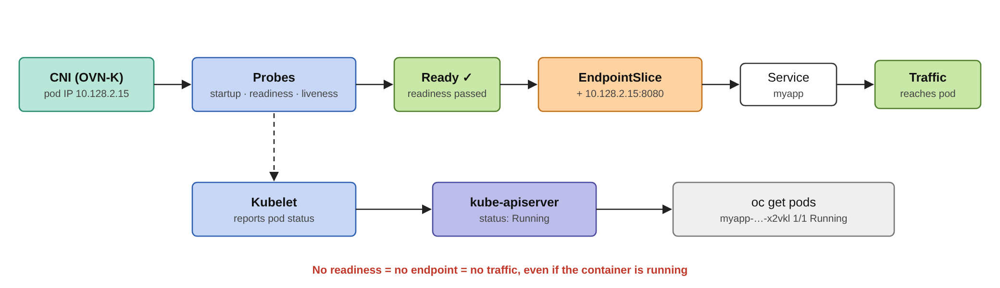

---

## Step 8 — The loop never stops

Every controller runs a **reconcile loop**: "desired vs. actual." Pod crashes? ReplicaSet notices 2/3 and creates a replacement — it doesn't restart it, it makes a **new pod** (possibly on another node).

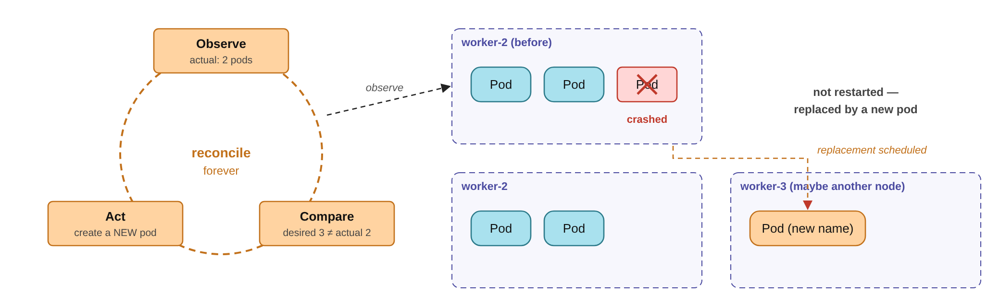

> **Core idea of Kubernetes:** Declarative desired state + continuous reconciliation.

---

## On `oc rollout` / update

Same flow, one twist: the Deployment controller creates a **new ReplicaSet** (`myapp-8f4e...`) and gradually **scales it up** while **scaling the old one down** — `maxSurge` / `maxUnavailable` control the pace. The old ReplicaSet is kept (scaled to 0) for `oc rollout undo`.

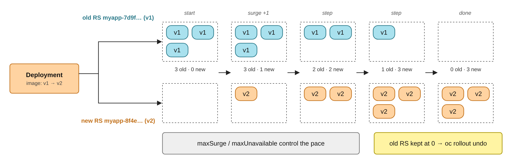

---

## The mental model

```text
You → API server → etcd (desired state)
                        ↓ watch
   Deployment ctrl → ReplicaSet ctrl → Pods (Pending)
                        ↓
                   Scheduler → binds pod → node
                        ↓
              Kubelet + CRI-O + CNI → container runs
                        ↓
              Probes pass → Endpoints → traffic
```

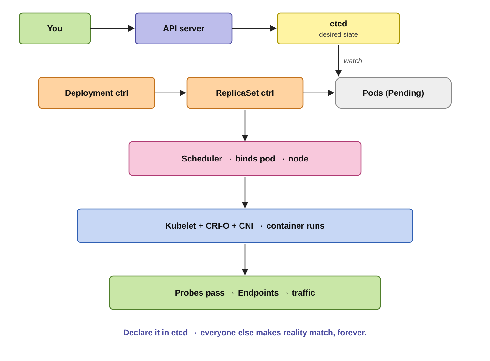

> **One-line summary:** You declare what you want in etcd; controllers, the scheduler, and kubelets independently conspire to make reality match it — and keep matching it forever.

---

## Where it commonly breaks

Both of these have been seen on the lab cluster:

- Stuck `Pending` → **scheduler found no node** (NotReady nodes, no capacity, taints)
- `Pending` forever **with node assigned** → **kubelet can't pull the image or can't reach the API** (expired certs — see Issue 07)

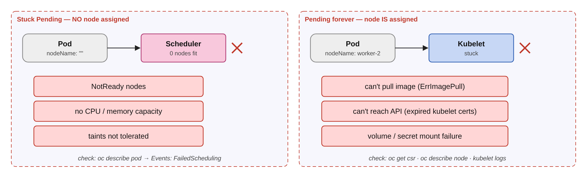

